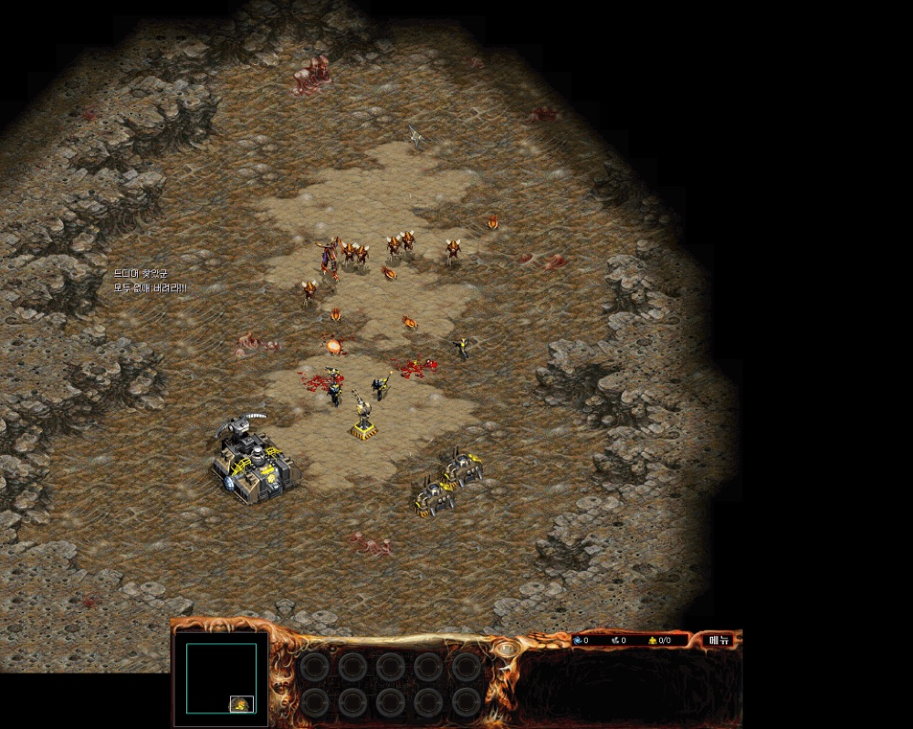

# 아트록스 1280x1024

아트록스(조이맥스)를 1280x1024 해상도로 실행되게 하는 실행파일 바이트 패치다. 해상도 모드 1 의 화면 크기를 800x600 에서 1280x1024 로 바꾸고, 800x600 에 맞춰 놓인 인터페이스를 넓어진 화면의 아래쪽 가운데로 옮겼다. 전체 화면판과, [아트록스 창모드](https://github.com/wnsrn3436/re-atrox-window-mode) 패치를 함께 넣은 창모드판이 있다. 바꾼 바이트와 어셈블리 해석은 [docs/resolution-patch.ko.md](docs/resolution-patch.ko.md) 에 있다.

**호환 버전**: 아트록스 v1.10 빌드 1 (UPX 를 푼 `atrox.exe`, md5 `b4c64c06c2afd830995ef497478718be`)

<p>
  
</p>


## 사용 방법

패치는 문서의 표를 보고 직접 적용한다.

1. 정품 `atrox.exe` 는 UPX 로 압축되어 있으므로 `upx -d` 로 먼저 푼다.
2. [docs/resolution-patch.ko.md](docs/resolution-patch.ko.md) 의 조합 표에서 전체 화면판이나 창모드판을 고르고, 해당 표의 파일 오프셋마다 헥스 에디터로 원래 바이트를 확인한 뒤 바꾼 바이트로 덮어쓴다.
3. 고친 실행파일을 아트록스 폴더에서 실행한다.

전체 화면판에서 화면이 깨지면 `docs/Atrox 1280 x 1024.bat` 으로 실행한다. 윈도우 탐색기를 끈 채로 게임을 실행하고, 게임을 끈 뒤 아무 키나 누르면 탐색기를 다시 켠다. 배치 파일은 `C:\Program Files\Joymax\Atrox\Atrox 1280 x 1024.exe` 를 실행하므로 고친 실행파일을 이 이름으로 두거나 배치 파일의 경로를 고친다.

창모드판의 스크롤 설정은 창모드 패치와 같다. 게임 옵션의 마우스 스크롤과 키보드 스크롤을 세 번째 칸에 맞춘다.


## 구현 원리

**모드 1 의 크기를 바꾼다.** 해상도 설정 함수는 모드 0 이면 640x480, 1 이면 800x600 을 쓴다. 옵션에 저장된 모드 대신 늘 1 을 넘기게 하고, 모드 1 쪽의 너비와 높이 즉값을 1280 과 1024 로 바꿨다.

```
004DC85F  C7 40 20 00 05 00 00  mov  [eax+0x20], 1280 ; 너비 (원래 800)
004DC866  E8 1A BD F2 FF        call 0x00408585
004DC86B  C7 40 24 00 04 00 00  mov  [eax+0x24], 1024 ; 높이 (원래 600)
```

**인터페이스 좌표를 옮긴다.** 아래쪽 인터페이스와 관련 요소의 위치는 800x600 기준 상수로 코드에 들어 있다. x 에는 240 ((1280 - 800) / 2), y 에는 424 (1024 - 600) 를 더해 800x600 크기의 인터페이스가 큰 화면의 아래쪽 가운데에 붙게 했다. 화면 높이의 절반을 구하는 자리 하나는 즉값이 없어서, 빈자리로 점프해 높이에 424 를 더한 뒤 절반을 구하고 돌아오게 했다.


## 파일

| 경로 | 내용 |
|---|---|
| `docs/resolution-patch.ko.md` | 대상 파일, 판 조합, 바꾼 바이트 표, 어셈블리 해석 |
| `docs/Atrox 1280 x 1024.bat` | 화면이 깨질 때 탐색기를 끄고 실행하는 배치 파일 |
| `docs/screenshots/` | 스크린샷 |


## 크레딧

`Atrox 1280 x 1024.bat` 은 감자동(zero_death)님이 만든 것이다.


## 라이선스

zlib 라이선스다. 자세한 내용은 [LICENSE](LICENSE) 에 있다. 함께 들어 있는 것 중 다른 사람이 만든 라이브러리는 각자의 라이선스를 따른다.
